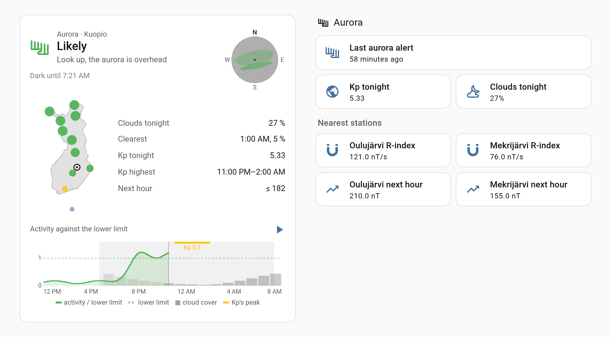
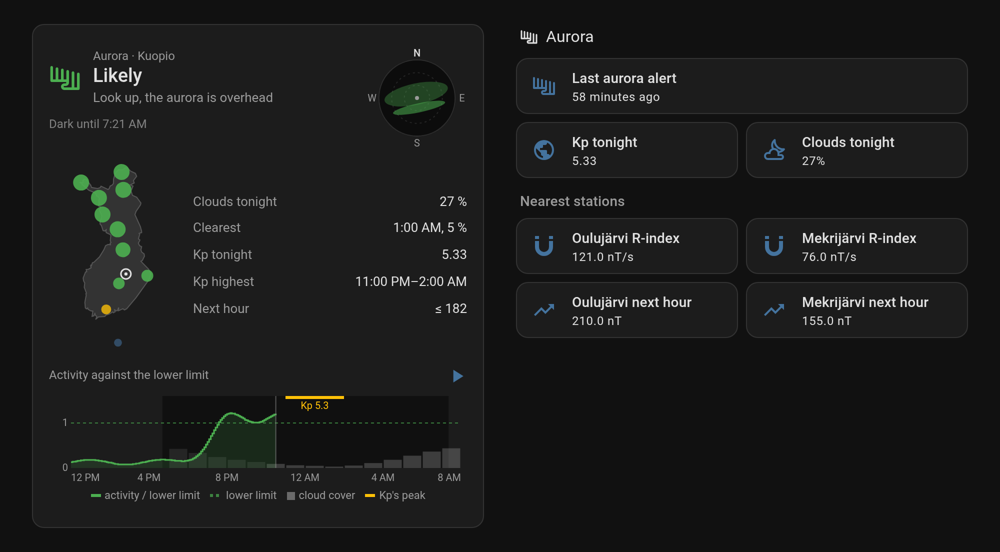
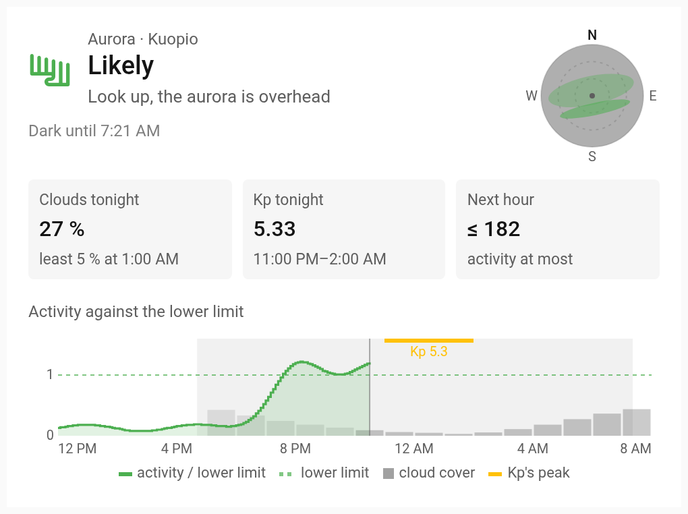
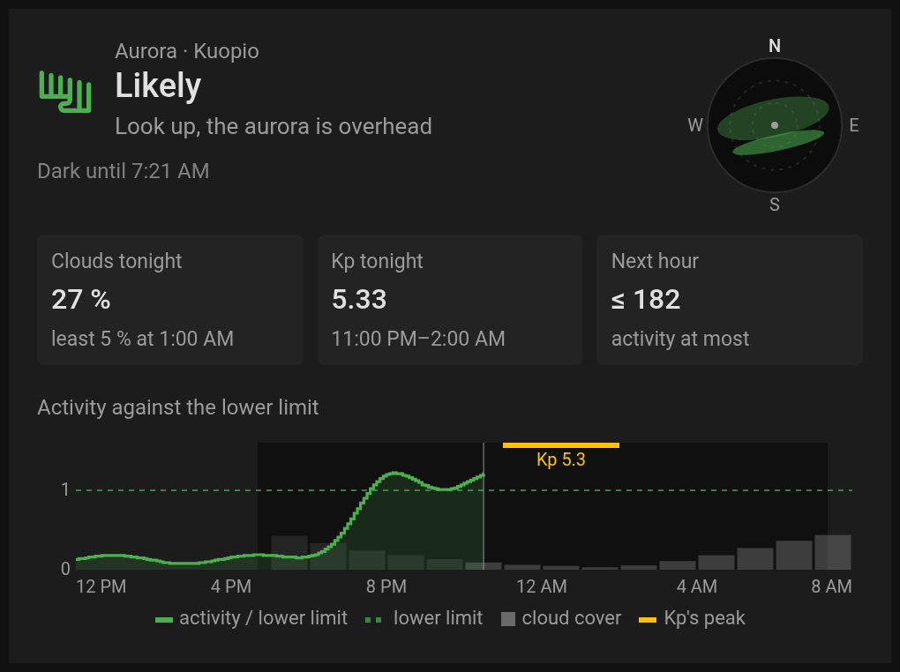
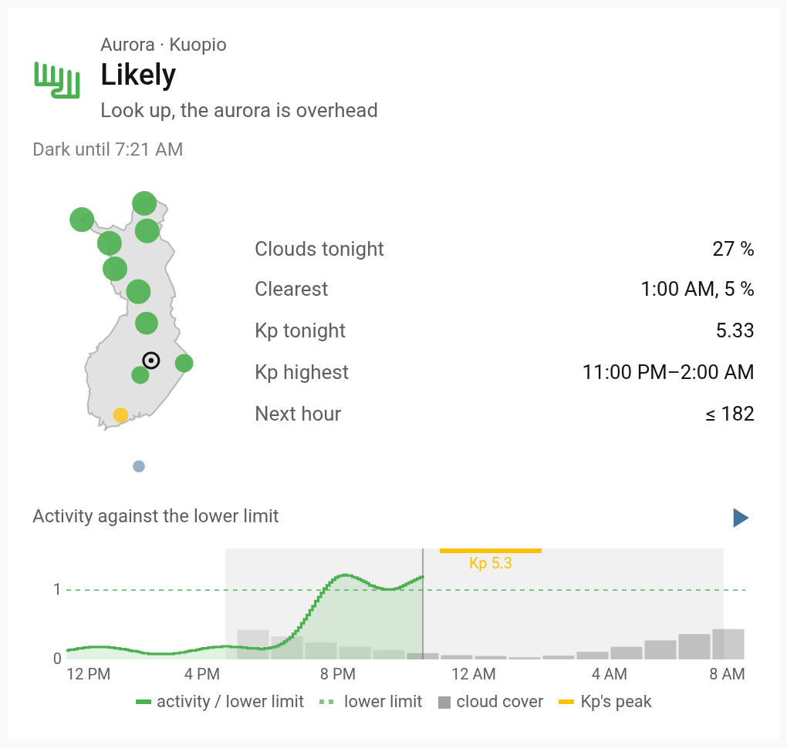
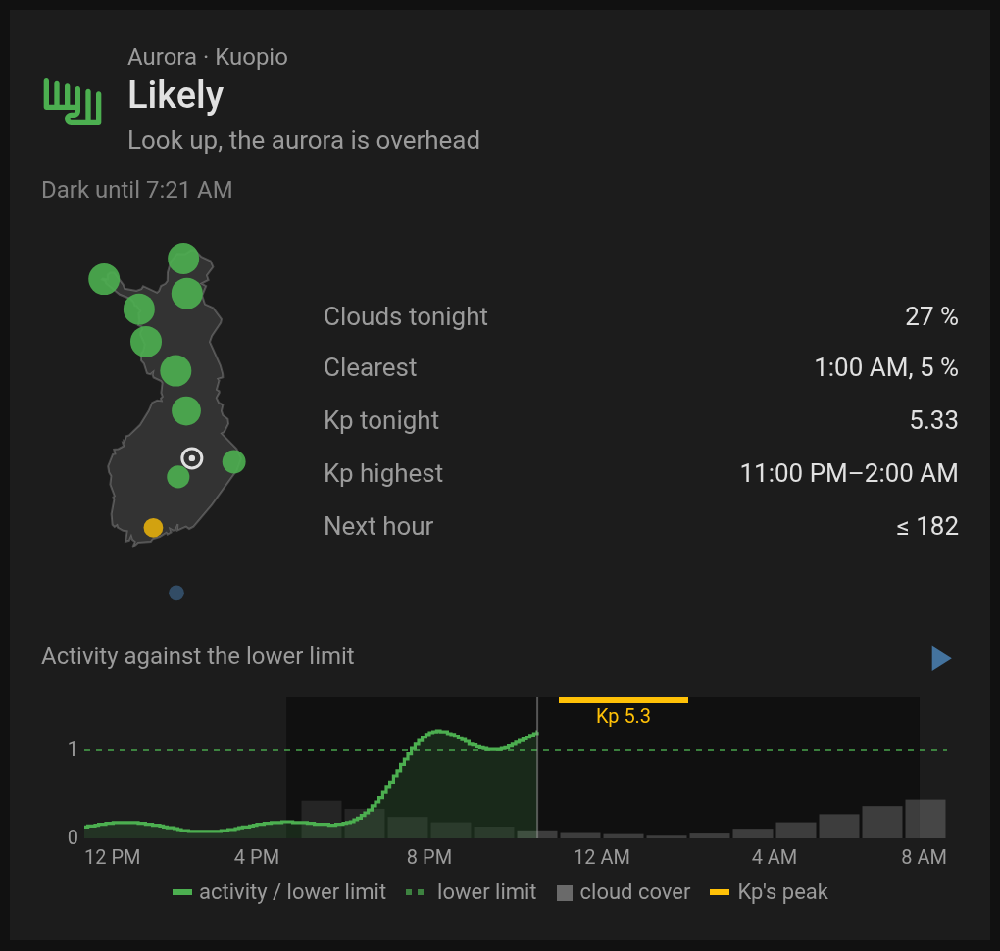

# Aurora Finland for Home Assistant

Home Assistant integration for the aurora over Finland, from the Finnish Meteorological Institute's magnetometers.

[![GitHub Release][releases-shield]][releases] [![GitHub Release Date][release-date-shield]][releases] [![Downloads][downloads-shield]][releases] [![Marketplace][marketplace-shield]][marketplace] [![License][license-shield]](LICENSE)




## What is it?

A custom component that tells whether the aurora can be seen from a place now, and where to look. It reads the
R-index of the Finnish Meteorological Institute's eleven magnetometer stations, from Kevo in the north to Tartu in
Estonia, every five minutes. The R-index is how fast the earth's magnetic field is changing at a station, and FMI's own
aurora alerts go by it.

For each place you add, it estimates the aurora's visibility from the stations around the place, and fires an event
when an aurora becomes likely after dark, for an automation to announce. It also gives the night's highest Kp from
NOAA's forecast, and, given a weather entity, the night's cloud cover.

Every station gets a device of its own with its R-index and FMI's RX, so the stations' history is kept by Home
Assistant like any other sensor's, to chart or to replay a night afterwards.

## Installation

### With the Marketplace

1. Open Settings › Marketplace, choose Add from link and paste `https://github.com/jesmak/aurora_finland`
2. Open Aurora Finland in the Marketplace and choose Install
3. Restart Home Assistant
4. Add the integration in Settings › Devices & services, and choose a place

### Manual

1. Download the source code from the latest release
2. Copy the `custom_components/aurora_finland` folder to your Home Assistant installation's `config/custom_components`
   folder
3. Restart Home Assistant
4. Add the integration in Settings › Devices & services, and choose a place

## Settings

Each place is added as an entry of its own, so add the integration again for another place. **Reconfigure** on an
entry changes any of its settings.

| Name             | Type     | Description                                                                     | Default          |
| ---------------- | -------- | ------------------------------------------------------------------------------- | ---------------- |
| Name             | string   | The name of the place's device, which its sensors' names start with             | your home's name |
| Location         | location | The place to estimate the aurora's visibility for                               | your home        |
| Weather forecast | entity   | A weather entity with an hourly forecast, for the night's cloud cover. Optional |                  |

## Sensors

The examples here use a place called Home and Home Assistant in English. The names follow Home Assistant's language,
and so do the IDs of newly created sensors. In Finnish, for instance, the visibility sensor of a place called Koti is
`sensor.koti_revontulten_nakyvyys`.

### The place

| Sensor                          | What it holds                                                        |
| ------------------------------- | -------------------------------------------------------------------- |
| `sensor.home_aurora_visibility` | `unlikely`, `possible` or `likely`, the aurora's visibility now      |
| `sensor.home_kp_tonight`        | The highest Kp forecast for the night's dark hours                   |
| `sensor.home_clouds_tonight`    | The night's mean cloud cover, in percent, with a weather entity only |

The visibility sensor's attributes:

- `view`: where to look, `overhead`, `north` or `not_visible`
- `elevation`: how high above the northern horizon the aurora is seen, in degrees, when one is seen there
- `ratio`: the activity over the place against the lower limit of the stations around it, where 1 is the limit
- `dark`: whether the sun is at least 10° below the horizon
- `dark_start` and `dark_end`: the night going on now, or the next one, by that same darkness. Either is empty when
  the sun stays that low for more than three days, and both when no such night comes, as in the summer
- `next_hour`: the highest RX FMI expects in the next hour at the stations around the place, weighed as for `ratio`
- `latitude` and `longitude`: the place, for the card's map

The night runs from civil dusk to dawn, or from now when it is already past dusk. The Kp sensor carries the three
hours it is forecast for as `start` and `end`. Kp is NOAA's planetary index, the same for the whole earth, so it says
how active the night may become, not whether the aurora will be over the place. The clouds sensor carries the clearest
hour's cover as `least`, that hour as `clearest`, and every hour of the night as `hours`, a list of `time` and
`cloud_coverage`. On a night with no dusk, as in the summer in the north, the two are unavailable.

### The stations

Each station is a device, under the place's device, named as FMI names it. For Nurmijärvi:

| Sensor                                         | What it holds                               |
| ---------------------------------------------- | ------------------------------------------- |
| `sensor.nurmijarvi_r_index`                    | The R-index over the last ten minutes       |
| `sensor.nurmijarvi_activity_past_hour`         | FMI's RX for the past hour                  |
| `sensor.nurmijarvi_activity_next_hour_at_most` | The highest RX FMI expects in the next hour |

The R-index sensor carries the station's `lower_limit` and `upper_limit`, the time of the reading as `time`, and the
station's `latitude` and `longitude`. FMI gives each station limits of its own. At the lower limit an aurora is more
likely than not over the station, and at the upper a bright one is. The R-index and RX files don't list quite the same
stations, so a station may have only one of the two kinds.

With a second place added, the stations are added again under it.

### How visibility is estimated

The estimate is this integration's own rule of thumb, not FMI's, and it hasn't been checked against sightings.

1. **Overhead.** The two stations nearest the place's latitude, one south of it and one north, are weighed by how
   close the place is to each, and their R-index is compared with their limits. A place beyond the outermost station
   uses that station alone.
2. **In the north.** A station north of the place whose aurora would be seen from the place high enough above the
   horizon, by its distance and the earth's curvature, with the aurora's lower edge at about 110 km. A station at its
   upper limit counts from 12° above the horizon, one at its lower limit from 30°.

The visibility is `likely` when the activity overhead reaches the upper limit, or reaches the lower limit with a
bright aurora in the north too. It is `possible` when the activity overhead reaches the lower limit, or an aurora is
seen in the north, and `unlikely` otherwise. It takes no account of daylight, the moon or clouds. `dark` and the clouds
sensor are there for that.

## Events

`event.home_aurora` fires `likely` when the visibility turns `likely` while it is dark, or it gets dark while the
visibility is `likely`. It carries `view`, `elevation` and `ratio` as at that moment. It doesn't fire on the first
update after a restart, so a restart in the middle of an aurora doesn't announce it again.

## Card

<p>




</p>

The integration comes with a dashboard card for one place. It shows the visibility now and where to look, with the
parts you choose under it.

- **Sky:** where to look, drawn on the sky seen from below, north at the top.
- **Tonight:** the night's cloud cover and its clearest hour, the highest Kp and when, and the most activity FMI expects
  in the next hour.
- **Station map:** FMI's stations on a map of Finland, coloured by their R-index against their own lower limit. The
  replay button plays the night from noon, or on from a moment held or paused at, so you can see how the activity
  moved.
- **The night's timeline:** the activity over the place against the lower limit, from noon to eight the next morning,
  with the dark hours shaded and the lower limit as a dashed line at 1. Before noon it shows the night just gone. The
  night's cloud cover and Kp's peak can be drawn on it too. Moving over it shows the activity and the clouds at that
  moment in a tooltip. Clicking it holds the whole card at that moment, the visibility, the sky and the map, until
  you click Now, press Esc or click the hours still to come. While it is held, the map's stations show their readings
  of that moment when you move over them. The place itself is on the map too.

The timeline comes from the visibility sensor's history in Home Assistant's recorder, and the map's replay from the
stations' R-index sensors, so both fill in from the moment the integration is set up. The hours gone by in the cloud
cover come from the clouds sensor's history. Each is the last forecast made for that hour, not an observation.

The integration serves the card itself and adds it to the dashboards' resources when it starts, so the card is always
the integration's own version. With the resources set in YAML (`resource_mode: yaml`), it can't add or update
itself, and the log says which line to add, change or remove.

### Card options

The card has a visual editor. Add **Aurora Finland** from the card picker and choose the place's visibility sensor. The
card finds the place's other sensors and its stations through it. The options can also be written by hand, and
`height_mode`, `height` and `max_height` only by hand. In a sections view the layout tab sets the card's height. They
are for where there is no layout tab, such as a masonry or panel view, or a stack or other card the card is inside,
even in a sections view.

| Name            | Type    | Description                                                                                                                                                                                                                                                                                                                | Default                                                                         |
| --------------- | ------- | -------------------------------------------------------------------------------------------------------------------------------------------------------------------------------------------------------------------------------------------------------------------------------------------------------------------------- | ------------------------------------------------------------------------------- |
| `type`          | string  | `custom:aurora-finland-card`                                                                                                                                                                                                                                                                                               | required                                                                        |
| `entity`        | string  | A place's visibility sensor                                                                                                                                                                                                                                                                                                | required                                                                        |
| `show_sky`      | boolean | Where to look, drawn on the sky                                                                                                                                                                                                                                                                                            | `true`                                                                          |
| `show_tonight`  | boolean | Tonight's cloud cover, Kp and the next hour's activity                                                                                                                                                                                                                                                                     | `true`                                                                          |
| `show_map`      | boolean | The station map, with the replay of the night                                                                                                                                                                                                                                                                              | `false`                                                                         |
| `show_timeline` | boolean | The night's timeline                                                                                                                                                                                                                                                                                                       | `true`                                                                          |
| `show_clouds`   | boolean | Tonight's cloud cover on the timeline, hour by hour                                                                                                                                                                                                                                                                        | `true`                                                                          |
| `show_kp`       | boolean | Kp's peak on the timeline                                                                                                                                                                                                                                                                                                  | `true`                                                                          |
| `height_mode`   | string  | How tall the card is. `auto` fits its content, `fixed` keeps it at `height`, `max` lets it grow up to `max_height`. The card is never held lower than its parts need. A height in grid rows, set in the layout tab of a sections view, is used instead                                                                     | `fixed` when `height` is set, `max` when only `max_height` is, otherwise `auto` |
| `height`        | number  | The card's height in pixels, for `fixed`                                                                                                                                                                                                                                                                                   |                                                                                 |
| `max_height`    | number  | The card's greatest height in pixels, for `max`                                                                                                                                                                                                                                                                            |                                                                                 |
| `row_step`      | string  | How the card rounds its height on automatic rows in a sections view, with `height_mode` `auto` or `max`. `full` rounds it up to whole rows, so the cards under it stay on the rows. `half` rounds it up to half rows, which saves space but can leave the cards under it half a row off the rows of the sections beside it | `full`                                                                          |

In a sections view the card takes a whole section, as the map and tonight's list need its width.

## Examples

A notification when the aurora is likely:

```yaml
alias: Aurora likely
triggers:
  - trigger: state
    entity_id: event.home_aurora
    not_from: unavailable
conditions:
  - condition: state
    entity_id: event.home_aurora
    attribute: event_type
    state: likely
actions:
  - action: notify.notify
    data:
      title: Aurora likely
      message: >-
        
          Look up, the aurora may be overhead.
        
          Look north, about {{ trigger.to_state.attributes.elevation }}° above the horizon.
        
```

## Data

The R-index and RX come from the [Finnish Meteorological Institute](https://space.fmi.fi/MIRACLE/RWC/), licensed
under [CC BY 4.0](https://creativecommons.org/licenses/by/4.0/). FMI updates both files every five minutes.

The Kp forecast comes from NOAA's
[Space Weather Prediction Center](https://www.swpc.noaa.gov/products/planetary-k-index), checked every half hour.

The files are only downloaded again when they have changed. No account or key is needed.

The card's map of Finland is drawn from [Natural Earth](https://www.naturalearthdata.com/)'s countries, which are in
the public domain.

This integration is unofficial and not affiliated with or endorsed by the Finnish Meteorological Institute or NOAA.

## Development

Requires Python 3.14.

```
python3.14 -m venv .venv
.venv/bin/pip install -r requirements_test.txt
.venv/bin/pytest
.venv/bin/ruff check .
```

The card is in `frontend/` and requires Node 22.13 or newer:

```
cd frontend
npm install
npm run check
```

`npm run check` typechecks, lints, checks formatting, runs the tests and builds
`custom_components/aurora_finland/www/aurora-finland-card.js`, which is the file the integration serves and is
committed to the repository. The card carries the integration's version from `manifest.json`. To have git refuse a
commit whose built card doesn't match `frontend/`, run `git config core.hooksPath .githooks` once.

| Path                           | What it contains                                                                 |
| ------------------------------ | -------------------------------------------------------------------------------- |
| `__init__.py`                  | Setup and the place's device                                                     |
| `config_flow.py`               | Adding and reconfiguring a place                                                 |
| `const.py`                     | The sources' addresses and the update intervals                                  |
| `api.py`                       | Downloading the files, only when they have changed                               |
| `feeds.py`                     | Reading FMI's and NOAA's files                                                   |
| `estimate.py`                  | The visibility estimate, the next hour's forecast, the dark hours, Kp and clouds |
| `coordinator.py`               | The three updates and the event's trigger                                        |
| `sensor.py`                    | The place's and the stations' sensors                                            |
| `event.py`                     | The event for a likely aurora                                                    |
| `card.py`, `www/`              | Serving the card and adding it to the dashboards' resources                      |
| `translations/<language>.json` | Home Assistant UI texts                                                          |
| `frontend/`                    | The card's source, tests and build                                               |

## Support

Hey dude! Help me out for a couple of :beers: or a :coffee:!

[](https://www.buymeacoffee.com/jesmak)

## License

MIT, see [LICENSE](LICENSE). FMI's data is licensed under CC BY 4.0, see [Data](#data).

[releases-shield]: https://img.shields.io/github/release/jesmak/aurora_finland.svg?style=for-the-badge
[release-date-shield]: https://img.shields.io/github/release-date/jesmak/aurora_finland?style=for-the-badge
[releases]: https://github.com/jesmak/aurora_finland/releases
[downloads-shield]: https://img.shields.io/github/downloads/jesmak/aurora_finland/total.svg?style=for-the-badge
[marketplace-shield]: https://img.shields.io/badge/Marketplace-Custom-orange.svg?style=for-the-badge
[marketplace]: https://my.home-assistant.io/redirect/marketplace_repository/?owner=jesmak&repository=aurora_finland&category=integration
[license-shield]: https://img.shields.io/github/license/jesmak/aurora_finland.svg?style=for-the-badge
